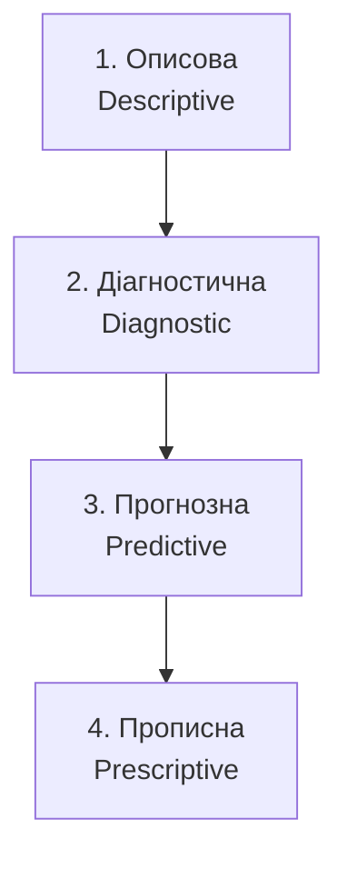
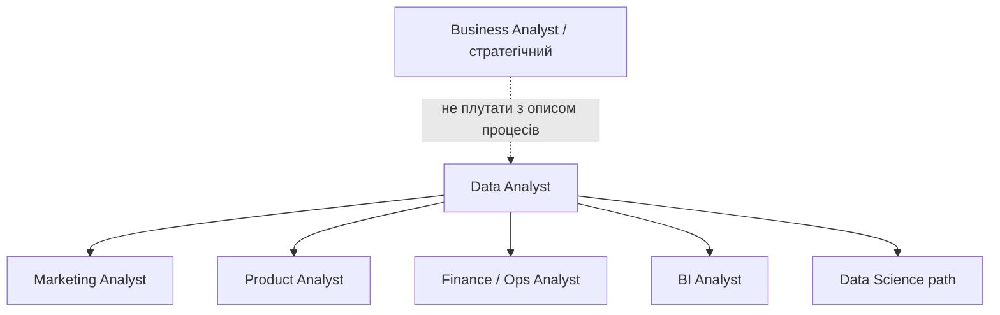

# 1.1. Хто такий дата-аналітик — цінність для бізнесу

> Модуль 1 · Вступ до Дата-аналітики  
> Спікерка: Ганна Шепелєва · ≈ 29:25  
> Джерело: Genius.Space (конспект за лекцією + субтитрами)

---

## Головна ідея

Дата-аналітик — **«перекладач» між даними і бізнесом**: аналізує й інтерпретує дані, робить звіти/дашборди й дає рекомендації, а не просто «будує графіки».

---

## Ключові терміни

| Термін | Сенс |
|--------|------|
| Descriptive | Описова аналітика: що сталося |
| Diagnostic | Діагностична: чому так |
| Predictive | Прогнозна: що ймовірно буде |
| Prescriptive | Прописна: що робити / яку дію обрати |
| Бізнес-вимоги | Питання/задача від менеджерів і команд |
| Трансформація даних | Зміна гранулярності, агрегація, приведення до потрібного вигляду |
| Атрибуція | Кому з каналів «присвоїти» клієнта/конверсію |
| Когорта | Група користувачів за спільною ознакою/часом старту |

---

## 1. Роль дата-аналітика

На слайді «Хто такий data-analyst?» три пункти:

1. Аналізує та інтерпретує дані  
2. «Перекладач» між даними та бізнесом  
3. Створює звіти, дашборди, рекомендації  

Цінність = **висновок для рішення**, не сира таблиця.

---

## 2. Як опановувати аналітику поступово

### 1) Описова (фундамент)

- Зчитувати, очищати, візуалізувати дані  
- Excel / Google Sheets, **SQL**, звіти й дашборди  
- SQL особливо важливий при великих обсягах і масштабуванні  

### 2) Діагностична

- Інтерпретація, глибший research поведінки  
- Математичний бекграунд: кореляція, сегменти, середнє / медіана / мода  
- Вчити через **кейси**, не лише формули  

**Приклад з лекції (Megogo):** різні міри центральної тенденції дають різну «картину» частоти покупок — і різні рішення щодо знижки.

### 3) Прогнозна

- Елементи Data Science: Python, ML, регресії, дерева рішень  
- Прогнози реєстрацій, revenue, churn, частоти покупок  
- Важливо розрізняти **кількісні** й **категоріальні** прогнози  

### 4) Прописна

- Авторекомендації, оптимізація, симуляції, AI-рішення / агенти  
- AI може допомагати з візуалізацією й поясненням просадок на дашборді  

> Старт кар’єри джуніора: **описова + діагностична**. Далі розвиваєшся паралельно з роботою.

---

## 3. Робочий день / цикл роботи аналітика

Орієнтовна структура часу (зі слайду спікерки):

| Етап | ≈ частка дня |
|------|----------------|
| Збір бізнес-вимог | ~10% |
| Збір + очищення | ~30% |
| Аналіз | ~30% |
| Візуалізація / презентація | ~20–30% |

Після презентації з’являються **нові питання** — цикл повторюється.

### Що робимо на кожному кроці

1. **Вимоги** — від продукту / маркетингу / фінансів (впали метрики, новий контракт, ціна…).  
2. **Збір** — CRM, Sheets, БД, BigQuery тощо.  
3. **Очищення/трансформація** — дублі, пусті значення, типи, денна→місячна гранулярність, групування.  
4. **Аналіз** — сегменти, канали, країни, ціни; сумнів до даних (іноді «просадка» = збій збору).  
5. **Презентація** — питання: *хто дивитиметься? як часто? якою мовою?* (аналітикам можна код/запит; стейкхолдерам — чиста візуалізація).

---

## 4. Типи аналітиків (не плутати ролі)

- **Data Analyst** — дані → інсайти → рекомендації.  
- **Business Analyst** — у вакансіях інколи = опис процесів; інколи = стратегічний «перекладач» KPI. **Читай опис вакансії.**  
- **Product Analyst** — поведінка в продукті, воронки, retention, A/B, web / iOS / Android.  
- **Marketing Analyst** — кампанії, ROI, **атрибуція**, когорти.  
- **Finance Analyst** — доходи/витрати, платежі, банки, статуси транзакцій.  

**Атрибуція (коротко):** клієнт міг побачити Facebook → Instagram → відгуки → встановлення. Кому зарахувати конверсію? Часто last-click, але є й інші моделі + вікно часу.  
**Когорти:** групи за стартом/поведінкою; зручно для повернень і середнього чека.

---

## 5. Питання для самоперевірки

1. Назвіть 4 рівні аналітики й приклад питання до кожного.  
2. Чому SQL у фундаменті навіть для стартапу?  
3. Опишіть цикл робочого дня аналітика.  
4. Чим product-аналітик відрізняється від marketing-аналітика?  
5. Навіщо сумніватися в даних, коли «впала» метрика?

---

## 6. Далі

**1.2. Навички під кожен напрямок дата-аналітики** — які skill’и потрібні в marketing / product / BI / finance.
