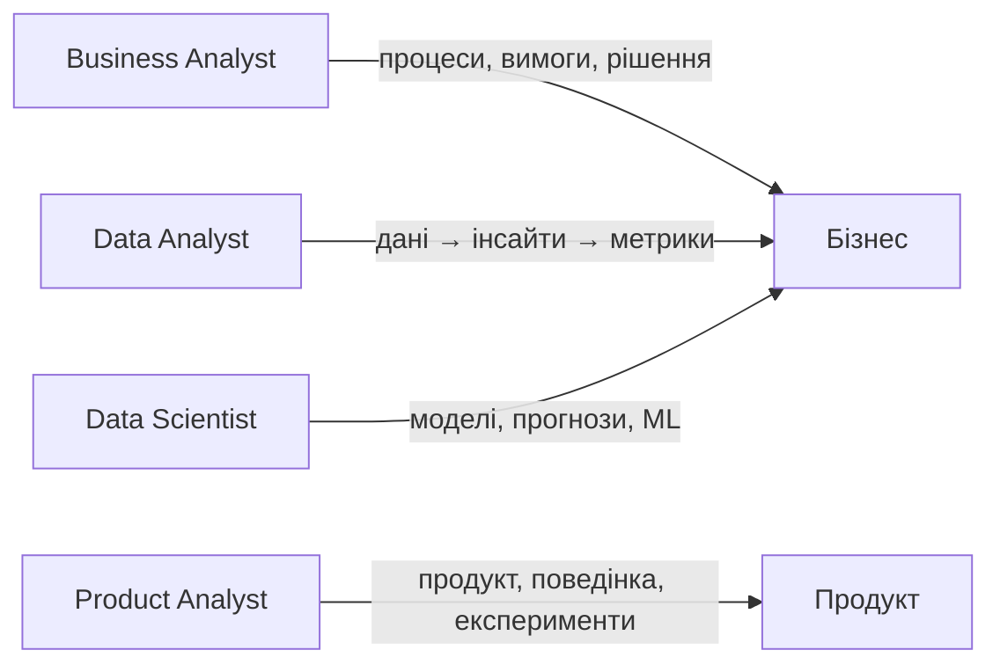
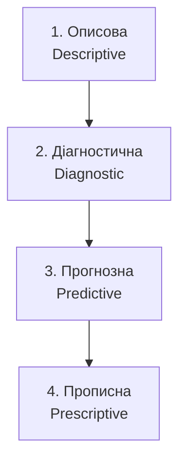

# 1.1. Хто такий дата-аналітик — цінність для бізнесу

> Модуль 1 · Вступ до Дата-аналітики  
> Спікерка: Ганна Шепелєва · Тривалість відео ≈ 29:25  
> Джерело: Genius.Space · Урок `hto-takii-data-analitik`

---

## Головна ідея

Дата-аналітик — це не «людина, яка будує графіки», а спеціаліст, який **перетворює дані на відповіді для бізнесу**: що сталося, чому, що буде далі і що робити.

---

## Ключові терміни

| Термін | Коротко |
|--------|---------|
| Data Analyst | Аналізує дані, будує звіти/дашборди, допомагає приймати рішення |
| Descriptive Analytics | Описова: що сталося |
| Diagnostic Analytics | Діагностична: чому так сталося |
| Predictive Analytics | Прогнозна: що ймовірно буде |
| Prescriptive Analytics | Прописна (приписова): що робити / яку дію обрати |
| Dashboard / звіт | Візуальне або табличне представлення метрик для бізнесу |
| Data Science / ML | Моделі та алгоритми для прогнозів і складніших висновків |

---

## 1. Хто такий дата-аналітик (зі слайдів)

На слайді **«Хто такий data-analyst?»** роль сформульовано трьома пунктами:

1. **Аналізує та інтерпретує дані**
2. **«Перекладач» між даними та бізнесом**
3. **Створює звіти, дашборди, рекомендації**

Тобто цінність = не сирий звіт, а зрозумілий висновок для рішення.

## 2. Цінність аналітика для бізнесу

Бізнес платить не за «таблиці», а за ясність:

1. **Що сталося?** (факти, динаміка, аномалії)
2. **Чому?** (причини, сегменти, фактори)
3. **Що це означає?** (вплив на гроші, користувачів, продукт)
4. **Що робити далі?** (гіпотези, пріоритети, експерименти)

### Відмінність ролей (орієнтир)

- **Data Analyst** — мова даних + бізнес-контекст + візуалізація/SQL.
- **Business Analyst** — більше про процеси, вимоги, організацію рішень.
- **Product Analyst** — метрики продукту, воронки, A/B, утримання.
- **Data Scientist** — глибше в моделі, статистику, ML.

На старті кар’єри важливо вміти **описувати й пояснювати дані**, а не одразу будувати складні моделі.

---

## 3. Як опановувати аналітику поступово (зі слайдів лекції)

На уроці показано 4 рівні аналітики — від простого до складного:

### 1) Описова аналітика (Descriptive)

**Мета:** навчитися зчитувати, очищати і візуалізувати дані — це фундамент.

**Практика:**
- Excel / Google Sheets
- SQL
- звіти та дашборди

**Питання бізнесу:** *Скільки продажів було минулого тижня? Який churn?*

### 2) Діагностична аналітика (Diagnostic)

**Мета:** коли вмієш описувати — шукай **причини змін**.

**Практика:**
- сегментація
- кореляції
- глибший аналіз поведінки користувачів

**Питання бізнесу:** *Чому впали продажі саме в сегменті X?*

### 3) Прогнозна аналітика (Predictive)

**Мета:** аналітика з елементами Data Science.

**Практика:**
- побудова моделей
- основи Python
- машинне навчання

**Питання бізнесу:** *Яка ймовірність, що клієнт піде наступного місяця?*

### 4) Прописна аналітика (Prescriptive)

**Мета:** найскладніший рівень — **автоматичні рекомендації** на основі даних.

**Практика:**
- оптимізація
- AI-рішення
- симуляції для прийняття рішень

**Питання бізнесу:** *Яку знижку дати, щоб максимізувати прибуток без шкоди для маржі?*

> Практичний висновок з уроку: **не стрибай одразу в ML**. Спочатку Descriptive → Diagnostic, і лише потім Predictive / Prescriptive.

---

## 4. Міні-модель роботи дата-аналітика

Чекліст перед будь-яким завданням:
1. Яке **бізнес-питання**?
2. Які **дані** потрібні і чи вони є?
3. Який **рівень аналітики** достатній (1–4)?
4. Як я **перевірю** висновок (якістю даних, сегментами, контролем)?
5. Як я **поясню** результат не-технічному стейкхолдеру?

---

## 5. Типові помилки новачків

- Починати з інструменту («зроблю дашборд»), а не з питання бізнесу.
- Показувати всі графіки підряд без висновку.
- Плутати кореляцію з причиною (Diagnostic ≠ просто «є зв’язок»).
- Стрибати в Python/ML без бази SQL + таблиць + метрик.
- Забувати про якість даних (сміття на вході → сміття на виході).

---

## 6. Питання для самоперевірки

1. Чим Data Analyst відрізняється від Data Scientist і Business Analyst?
2. Назвіть 4 рівні аналітики і приклад питання до кожного.
3. Чому Descriptive називають фундаментом?
4. Які інструменти згадуються на рівні описової аналітики?
5. Сформулюйте одне бізнес-питання і визначте, який рівень аналітики йому потрібен.

---

## 7. Що далі

Наступний урок: **1.2. Навички під кожен напрямок дата-аналітики** — які skill’и потрібні для різних гілок аналітики.

---

## Нотатки зі зйомки відео

- На слайді «Як опановувати аналітику поступово» детально розкрито 4 рівні (Descriptive → Diagnostic → Predictive → Prescriptive).
- Акцент: шлях навчання має бути **поступовим**.
- Частина відео ще дознімається автоматично; цей файл оновимо, якщо з’являться додаткові слайди/тези.
