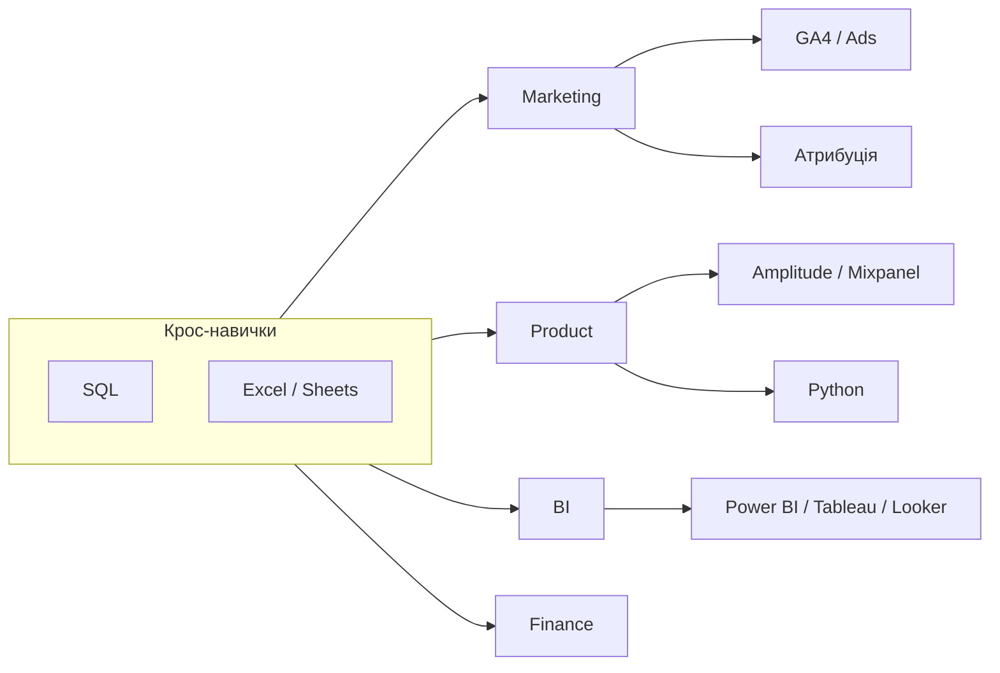

# 1.2. Навички під кожен напрямок дата-аналітики

> Модуль 1 · ≈ 33:56 · Ганна Шепелєва  
> Конспект за лекцією + субтитрами (не дослівний транскрипт)

---

## Головна ідея

Різні напрямки аналітики потребують **різного стеку**, але є **крос-навички** (SQL, Excel/Sheets), потрібні майже всюди. Важливо знати не «все підряд», а **що вивчати першим** і як зрозуміти, що навичку опановано.

---

## Карта напрямків і навичок

---

## 1. Маркетинг

| Навичка / інструмент | Навіщо |
|----------------------|--------|
| SQL | Вигрузки, сегменти, майже всюди |
| Excel / Sheets | База: зведені, формули |
| Google Analytics (+ Ads) | Креативи, кампанії, країни, аудиторії, ліди/клієнти |
| Power BI (дашборди) | Зняти рутину повторних запитів менеджерів |
| A/B тести креативів | Порівняння подач/креативів; потрібен достатній обсяг |
| Атрибуція | Як розділити цінність між каналами на шляху клієнта |

**Атрибуція (кейс):** Facebook → TikTok → Instagram → «сарафан» → Google Search → покупка $100. Не можна зарахувати $100 кожному каналу. Часто last-click; також час між касами / пропорційний поділ.

---

## 2. Продуктова аналітика

| Навичка / інструмент | Навіщо |
|----------------------|--------|
| SQL | База запитів |
| Amplitude / Mixpanel | Події, кліки, сесії, активність у застосунку/сайті |
| Python | Швидка обробка воронок, очищення, A/B, прогнози |
| A/B у продукті | Зміна UI/флоу (розділи, колір оплати, кроки форми) |
| Дашборди | У самій Amplitude **або** Power BI / Looker / Tableau |

**Воронка** — послідовність дій (реєстрація → логін → … → оплата).  
**Amplitude:** зручно для стартапів (є безкоштовний ліміт івентів); на великих обсягах — платна версія.

**Приклад A/B:** об’єднати «Фільми / Прем’єри» в один розділ, щоб користувач менше губився.

---

## 3. BI-аналітик

Окрема роль: **візуалізації та дашборди** для різних команд.

- Сильний **SQL** (вигрузка, фільтри, підготовка датасетів)  
- Інструменти: **Power BI**, **Tableau**, **Looker**, **Looker Studio**  

| Інструмент | Нотатка з лекції |
|------------|------------------|
| Looker Studio | Безкоштовніший варіант Google |
| Looker | Платний, більше можливостей |
| Power BI | Краще на Windows; на Mac — обмеження desktop |
| Tableau | Потужний, часто в великих компаніях, платний |

---

## 4. Інші напрямки (коротко)

- **Фінанси / ops** — платежі, статуси, банки, P&L-логіка (деталі — у курсі далі).  
- **Data Science** — наступний рівень після бази аналітика (моделі, ML); SQL там теж очікується.  

Багато навичок **перетинаються**: A/B є і в маркетингу, і в продукті; SQL — майже всюди.

---

## 5. Як оцінити, що навичку «опанував»

Практичний критерій з духу лекції:

- Можеш **самостійно** закрити типову задачу напрямку без підказок «зроби за мене».  
- Розумієш **навіщо** інструмент, а не лише кнопки.  
- Можеш пояснити результат бізнесу простою мовою.  

---

## Питання для самоперевірки

1. Які дві навички майже завжди крос-функціональні?  
2. Чим Amplitude відрізняється за роллю від Google Analytics?  
3. Навіщо атрибуція і чому last-click — не єдиний варіант?  
4. Коли Power BI може бути незручним вибором?  
5. Навіщо BI-аналітику сильний SQL?

---

## Далі

**1.3. Джерела даних. Типи даних** — звідки беруться дані і як їх розрізняти.
