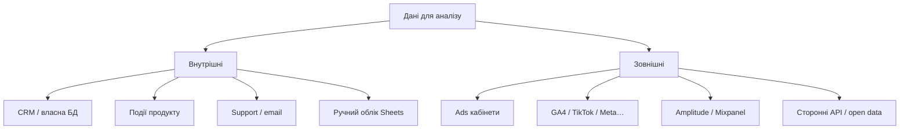

# 1.3. Джерела даних. Типи даних в аналізі даних

> Модуль 1 · ≈ 24:21 · Ганна Шепелєва  
> Конспект за лекцією + субтитрами

---

## Головна ідея

**Дані — основа аналітики.** Метрики (дохід, користувачі, середній чек, реєстрації…) рахуються з даних. Треба розуміти: **звідки** дані, **наскільки їм можна довіряти** і **як перевіряти**.

---

## 1. Джерела даних

### Внутрішні

Генерує / контролює компанія:

- база користувачів і транзакцій  
- продуктові івенти (як налаштували розробники)  
- саппорт / розсилки  
- навіть **ручні** Google Sheets із замовлень з Instagram/телефону  

**Плюси:** контроль, деталізація, можна швидко попросити доробку.  
**Мінуси:** залежність від черги розробників; збої під навантаженням (Black Friday); людський фактор у ручному введенні.

### Зовнішні

Платформи, якими ви **не керуєте повністю**:

- рекламні кабінети (Google, Meta, TikTok…)  
- GA4, Amplitude тощо  

**Плюси:** контекст (вік/стать з ads), трекінг того, чого немає всередині (push delivery тощо), конкурентний/ринковий контекст.  
**Мінуси:** вартість; різні правила підрахунку метрик; обмежений контроль; дані з різних платформ **часто не збігаються**.

---

## 2. Гранулярність і «сшивка» джерел (ETL-мислення)

Типовий біль: одне джерело віддає країну **погодинно по транзакції**, інше — **лише добово**.  
Щоб об’єднати — потрібна **однакова гранулярність** і зрозумілі правила ETL/злиття.

Перевіряй завжди:

- як часто оновлюється джерело  
- у якій таймзоні / валюті  
- чи збігаються визначення метрик  

---

## 3. Продуктові vs маркетингові дані

| Тип | Що описує | Приклади |
|-----|-----------|----------|
| Продуктові | Поведінка всередині продукту | events, funnel, retention |
| Маркетингові | Як люди прийшли / скільки коштувало | кампанії, креативи, CAC |

**Найбільша цінність — у поєднанні:**  
маркетинг привів аудиторію → продукт показує, що вона робить і чи повертається → можна оптимізувати витрати й гіпотези (наприклад, push краще в п’ятницю, якщо людина активна по п’ятницях).

---

## 4. Структура даних

- **Структуровані (табличні)** — найчастіше те, з чим працює аналітик.  
- **Неструктуровані / напівструктуровані** — тексти, профілі з різним набором полів (у одного юзера є вік/місто, у іншого — ні).

Різна структура ускладнює порівняння й вимагає правил очищення/нормалізації.

---

## 5. Якість даних = якість висновку

Перед аналізом питай:

1. Звідки поле?  
2. Хто / що його пише?  
3. Чи повне воно за період?  
4. Чи збігається з іншим джерелом?  
5. Чи можу я довіряти визначенню метрики?

---

## Питання для самоперевірки

1. Наведіть по 2 приклади внутрішніх і зовнішніх джерел.  
2. Чому дані з Facebook і Google Ads можуть «не битися»?  
3. Що таке гранулярність і навіщо вона при join джерел?  
4. Навіщо поєднувати продуктові й маркетингові дані?  
5. Чим структуровані дані зручніші для аналітика?

---

## Далі

**1.4. Огляд інструментів дата-аналітика** — Excel, SQL, DWH, BI, Python і коли що брати.
