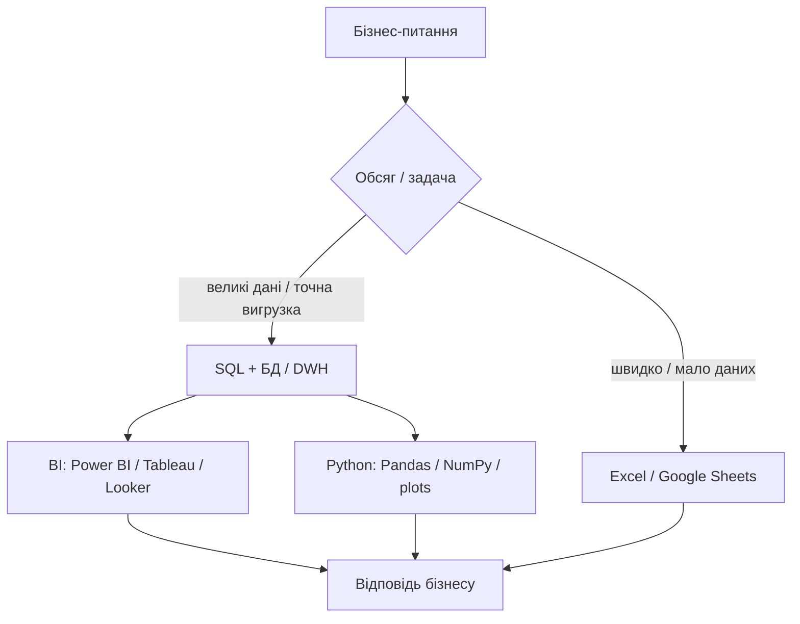

# 1.4. Огляд інструментів дата-аналітика

> Модуль 1 · ≈ 32:45 · Ганна Шепелєва  
> Конспект за лекцією + субтитрами

---

## Головна ідея

**Інструменти = «руки» аналітика.** Не треба знати все. Треба розуміти **для чого** кожен інструмент, **коли** його брати, і що стек залежить від напрямку та розміру компанії. Хороший аналітик **комбінує** інструменти.

---

## Карта стеку

---

## 1. Excel / Google Sheets

**Коли:** невеликі обсяги; разовий кейс; швидка перевірка гіпотез «на коліні»; легкий звіт для презентації.

**Плюси:** просто, швидкий старт, майже без техбар’єру, крос-напрямок.  
**Мінуси:**

- погано масштабується (орієнтир з лекції: проблеми вже біля великих обсягів / десятки тисяч рядків+)  
- високий ризик помилок (формули, посилання, кілька редакторів)  
- важко підтримувати квартал за кварталом  

> База — так. Фінальний інструмент для всього — ні.

---

## 2. SQL + бази даних

**Навіщо:** отримати, відфільтрувати, зджойнити таблиці, агрегувати метрики (сума, кількість юзерів, середній чек) на **великих** обсягах.

Чому критично:

- більшість даних живе в БД  
- найшвидший шлях до точної вигрузки потрібного сегмента  
- без SQL аналітик залежить від інших і обмежений у задачах  
- «статистик» з SQL — частий вхід у професію  

### DWH / типи систем (огляд)

| Поняття | Сенс |
|---------|------|
| Data Warehouse (DWH) | Централізоване сховище для аналітики з багатьох джерел |
| OLTP | Операційні / транзакційні системи (детальні транзакції) |
| OLAP | Аналітичні структури (агрегати по юзерах/продуктах тощо) |
| Single source of truth | Єдині правила: таймзона, валюта, оновлення |

Приклади технологій з лекції: **BigQuery**, **Snowflake**, **PostgreSQL** (синтаксис SQL близький, але діалекти відрізняються).

Хороший аналітик розуміє **звідки** таблиця, як часто оновлюється, які типи полів — не лише «як написати SELECT».

---

## 3. BI-інструменти (дашборди)

**Мета:** візуалізувати метрики, моніторити динаміку, дати бізнесу self-service без постійних «вишліть Excel».

| Інструмент | Нотатки |
|------------|---------|
| Looker Studio | Безкоштовніший Google-варіант; часто вистачає |
| Looker | Платний, більше можливостей / конекторів |
| Tableau | Сильний, зручне дослідження в самому BI; частіше в зрілих компаніях |
| Power BI | Сильний у Microsoft-екосистемі; на Mac desktop обмежений |

**Типові бізнес-питання на дашборді:**

- Маркетинг: CAC, чи окупилась реклама  
- Продукт: чи повертаються користувачі, шлях до покупки  
- Фінанси: скільки заробили, який прибуток  

Головне: дашборд має **відповідати на питання**, а не «просто показувати графік».

---

## 4. Python для аналізу

Для **складнішої** логіки: статистика, дослідження, ML-елементи, зручна обробка воронок/A/B.

Ключові бібліотеки з лекції:

- **Pandas** — таблиці  
- **NumPy** — обчислення  
- **Matplotlib / Seaborn** — графіки (Seaborn ближче до «зручної» візуалізації)  

**Коли вже потрібен Python:** складна логіка розрахунків, великі трансформації, перевірка гіпотез/A/B глибше, сегментація, базові прогнози — після впевненої бази SQL + таблиць.

---

## 5. Практичне правило пріоритезації навчання

1. Excel / Sheets — швидкий старт  
2. SQL — обов’язковий стрижень  
3. Один BI (залежно від ОС/компанії)  
4. Python — коли задачі стають складнішими  

Комбінуй: SQL вигрузка → Sheets для ad-hoc **або** BI для регулярного моніторингу → Python для важкого аналізу.

---

## Питання для самоперевірки

1. Коли Sheets достатньо, а коли вже ні?  
2. Чому SQL називають найшвидшим доступом до точних даних?  
3. Що таке DWH і single source of truth?  
4. Чим Looker Studio відрізняється від Looker за сенсом вибору?  
5. Назвіть 3 бібліотеки Python для аналітика і їх ролі.

---

## Підсумок Модуля 1

Після уроків 1.1–1.4 ти вже розумієш:

- хто такий аналітик і як він створює цінність  
- які навички потрібні в різних напрямках  
- звідки беруться дані і як перевіряти якість  
- який інструмент брати під задачу  

Далі за програмою курсу — практика в **Google Sheets / Excel** (Модуль 2).
