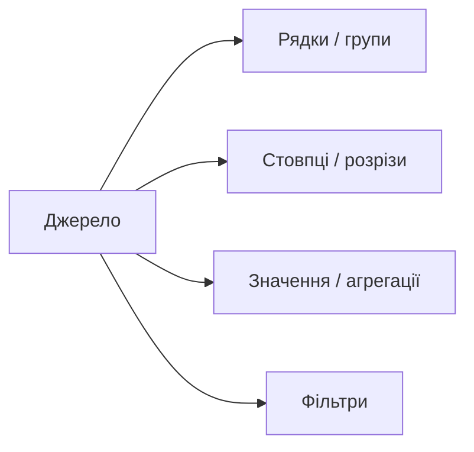

# 2.9. Зведені таблиці як інструмент аналізу

> Модуль 2 · Google Sheets / Excel Pivot

---

## Головна ідея

Зведена таблиця = швидка **агрегація + групування** великого очищеного набору без ручного `SUMIF` на кожну категорію.

Передумова: дані вже почищені (урок 2.7–2.8). Краще будувати з **розумної таблиці**.

---

## Будова зведеної

Типові агрегації:

- сума виручки  
- кількість замовлень (`COUNTA` для тексту)  
- середнє  
- кількість унікальних клієнтів (через правильне поле + Count)

---

## Практичні патерни з лекції

1. Додати розрахункове поле в джерелі (напр. `кількість * ціна` = сума рядка).  
2. Перетягнути виміри в рядки/стовпці, міри — у значення.  
3. Для тексту в значеннях — Count/COUNTA, не SUM.  
4. Порожній рядок у зведеній часто = пропуск у джерелі — повертайся чистити дані.  
5. Форматування: грошовий формат, копіювання формату «пензликом».

### Питання, які закриває зведена за хвилини

- Скільки виручки online vs магазин?  
- Скільки унікальних клієнтів за період?  
- Топ товарів / місяців?

---

## Самоперевірка

1. Чому зведену краще будувати після очистки?  
2. Коли в значеннях ставити Count, а не Sum?  
3. Звідки береться «порожній» рядок у зведеній?
