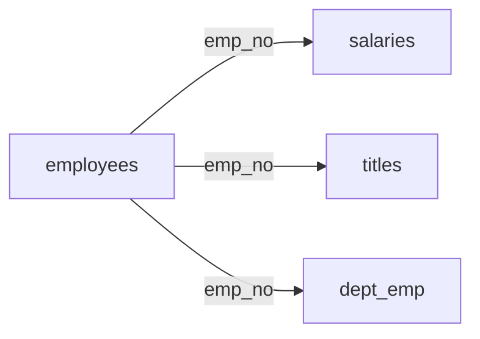

# 3.10–3.12. Дати/час і JOIN

> Модуль 3 · майже кожне бізнес-питання зав’язане на час і на кілька таблиць

---

## 3.10. Робота з датою та часом (MySQL)

Типові питання бізнесу: «сьогодні», «за останній місяць», «скільки років у компанії».

Корисні функції (орієнтири з лекції):

- `NOW()`, поточна дата/час сервера  
- функції «лише дата» / «лише час»  
- різниці дат, витягування року/місяця/дня  
- порівняння колонок типу `DATE`/`DATETIME` у `WHERE`

Завжди уточнюй **таймзону сервера** і формат збереження.

---

## 3.11–3.12. JOIN — серце аналітичного SQL

Через нормалізацію дані розкидані: users / orders / products / payments. JOIN збирає відповідь.



### Ідеї типів з’єднань

| JOIN | Результат |
|------|-----------|
| INNER | Лише збіги з обох сторін |
| LEFT | Усі з лівої + збіги з правої (без збігу → NULL) |
| RIGHT | Дзеркально до LEFT |
| FULL* | Усі з обох (*не всюди є нативно в MySQL) |

Ключ з’єднання — **стабільний ID** (`emp_no`), не ПІБ.

Практичне завдання з лекції: вивести ім’я співробітника + зарплату → `employees` ⋈ `salaries` по `emp_no`.

Шаблон:

```sql
SELECT e.first_name, e.last_name, s.salary
FROM employees.employees AS e
INNER JOIN employees.salaries AS s
  ON e.emp_no = s.emp_no
WHERE s.to_date = '9999-01-01';  -- приклад актуальної ставки, якщо так у датасеті
```

(Точні умови `to_date` звіряй зі схемою employees.)

---

## Підсумок модуля 3

Ти вмієш: підняти MySQL + Workbench, читати схему, писати `SELECT/WHERE/ORDER/LIMIT`, агрегувати, працювати з датами, з’єднувати таблиці через JOIN.

---

## Самоперевірка

1. Навіщо дати майже в кожному аналітичному запиті?  
2. INNER vs LEFT на прикладі «усі клієнти + їх замовлення».  
3. Чому JOIN по імені — погана ідея?
