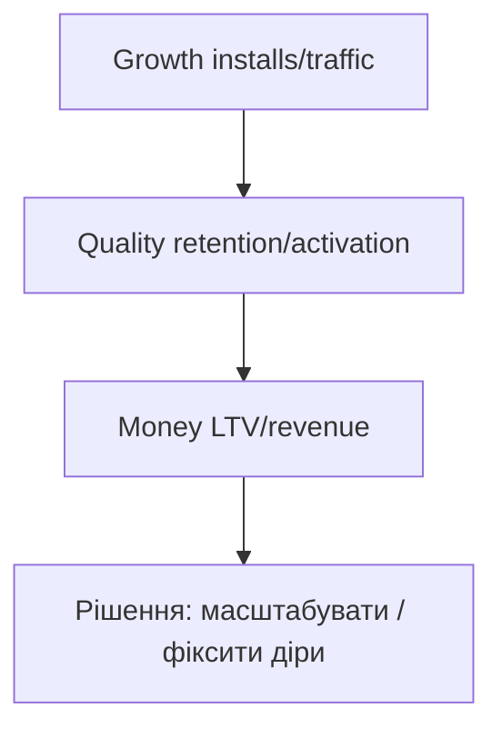

# 4.7–4.9. Сегменти, когорти, динаміка продукту

> Модуль 4

---

## 4.7. Сегментування

Не всі користувачі однакові: країна, девайс, платіжний метод, **роль у продукті**.

Приклади ролей:

- **Core users** — ядро (щоденно, глибоко користуються).  
- Менш активні / разові — інші патерни метрик.

Сегменти пояснюють *чому* середнє бреше: загальний retention може «тягнути» одне ядро.

---

## 4.8. Когортний аналіз

**Когорта** = хто прийшов в один період (тиждень/місяць інсталу).

Навіщо:

- чи стає продукт **кращим для нових** поколінь;  
- порівняти до/після фічі або зміни онбордингу;  
- відокремити сезонність від реального покращення.

Дивись метрики **всередині когорти в часі**, а не лише загальний DAU.

---

## 4.9. Як оцінити динаміку розвитку продукту

Розвиток ≠ тільки ріст кількості юзерів.

Питай:

1. Чи зростаємо в ключових метриках?  
2. Яка **якість** росту (retention, активація)?  
3. Чи **окупається** ріст (юніт-економіка)?  

Комбінуй volume + quality + monetization. Приклади метрик і логіки розрахунку — у лекції на кейсах відомих продуктів.

---

## Самоперевірка

1. Навіщо сегменти, якщо є «середній» retention?  
2. Яке головне питання закриває когортний аналіз?  
3. Чому «більше юзерів» недостатньо як визначення розвитку?
