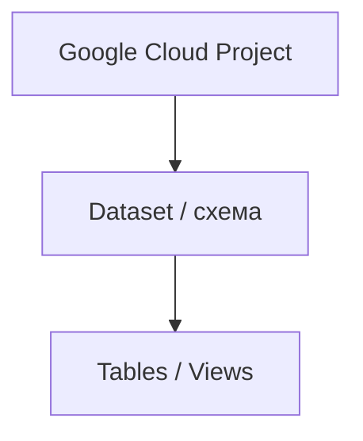

# 5.1–5.3. BigQuery: GCP, консоль, типи й дати

> Модуль 5 · Поглиблений SQL (BigQuery) · Ганна Шепелєва  
> Конспект за субтитрами (парафраз)

---

## 5.1. Що таке BigQuery

**Google Cloud** — набір хмарних сервісів; BigQuery — один із них (поруч із Sheets/Slides в екосистемі Google).

Навіщо аналітику:
- зберігати й обчислювати великі обсяги даних;
- фільтрувати / сортувати / вивантажувати через SQL;
- спільно працювати з одним проєктом з різних ноутбуків (достатньо Gmail);
- опційно — ML-моделі поверх даних (згадка в лекції).

Усі ресурси живуть у **проєктах**; доступ шериться ролями (читання / jobs / admin з білінгом і лімітами). До певного ліміту BigQuery безкоштовний; далі — картка в білінгу.

---

## 5.2. Практика: проєкт і завантаження

1. Залогінитись у Gmail → пошук «BigQuery console».  
2. Welcome → **SQL workspace**.  
3. Створити **Project** → **Dataset** → **Create table**.  
4. Джерела: Upload CSV, Cloud Storage, інші БД, API/сервіси.  
5. Формати: CSV / JSON / auto; перевірити схему колонок.

Ролі IAM: адмінські vs клієнтські. Частина операцій недоступна без картки.

---

## 5.3. Консоль, синтаксис, типи (у т.ч. дати)

### Інтерфейс

| Зона | Що там |
|------|--------|
| Explorer | дерево project → dataset → table/view |
| SQL editor | підсвітка, автодоповнення |
| Results | рядки + статистика скану / попередження |
| Preview таблиці | перші рядки **безкоштовно** (не сканує байти як query) |
| Job / Personal / Project history | історія запитів; Job ID → SQL, час, план |
| Saved queries | іменовані запити (private / shared), без schedule |

Ієрархія: **project.dataset.table** (крапка). Регіон датасету (EU / US) критичний: **JOIN між різними регіонами не працює**.

Шари даних (практика команди): bronze (сирі) → silver (оброблені) → gold (для дашбордів).

### SQL-нюанси BigQuery

- `FROM project.dataset.table` — повний шлях (щоб не плутати одноіменні таблиці).  
- `LIMIT` **не зменшує** скановані байти (на відміну від очікувань із Postgres); економія — через фільтри й потрібні колонки, не `SELECT *`.  
- Результат: **Save to table** (snapshot, не live), CSV/JSON (до ~1M рядків), Google Sheets (ліміт комірок).

### Типи даних

**Прості:** STRING, BOOL, BYTES; INTEGER / FLOAT / NUMERIC / BIGNUMERIC.  
**Дата-час:**
| Тип | Зміст |
|-----|--------|
| `DATE` | лише дата |
| `DATETIME` | дата+час без TZ |
| `TIMESTAMP` | абсолютний момент (UTC) — зручно зводити джерела |

STRING для «цифр» = більше місця + немає нормальної математики.

**Складні (на відміну від класичного MySQL-курсу):**
- `ARRAY` — колекція одного типу; розгортання через `UNNEST`
- `STRUCT` / Record — іменовані поля; доступ через `.`
- JSON / array\<struct\> — типовий вигляд продуктовіх івентів з API

Режими полів: NULLABLE / REQUIRED / REPEATED (масив).

---

## Самоперевірка

1. Чому Preview дешевший за `SELECT *`?  
2. Чому важливий регіон датасету?  
3. Коли брати `TIMESTAMP`, а коли `DATE`?
