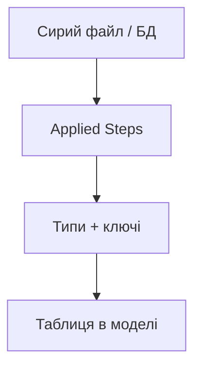

# 6.3–6.5. Імпорт даних і Power Query

> Модуль 6 · три частини Power Query

---

## Головна ідея

**Power Query** = ETL у Power BI: Get Data → кроки трансформації → Close & Apply. Кожен крок = рядок у Applied Steps (відтворюваний пайплайн).

Типові кроки:
- зміна типів (дата ≠ текст);
- Split / Merge колонок;
- Unpivot / Pivot;
- Remove duplicates / Replace errors;
- Append (стек) vs Merge (join);
- умовні колонки.

### Практика мислення

1. Спочатку **один** чистий факт (orders), потім довідники (products, clients).  
2. Не змішуй бізнес-логіку «на око» в Report — краще крок у Query або міра DAX.  
3. Імена кроків і колонок — зрозумілі українською/англійською без пробілів-хаосу.

---

## Самоперевірка

1. Append vs Merge?  
2. Навіщо фіксувати тип Date до моделі?
