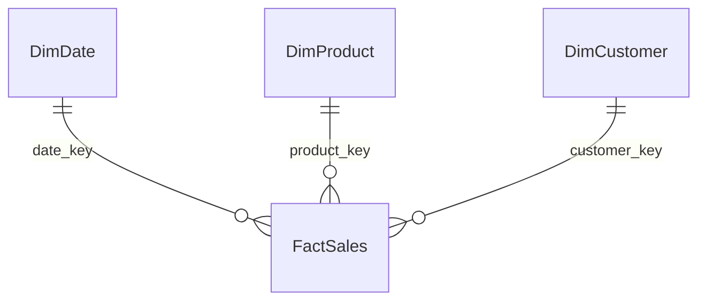

# 6.6–6.8. Моделювання та візуалізація

> Модуль 6 · star schema + charts

---

## 6.6. Моделювання даних

Мета: **star schema** — факт у центрі, виміри навколо.

| Таблиця | Приклад | Зерно |
|---------|---------|-------|
| Fact | продажі, сесії | один рядок = подія / рядок чека |
| Dim | дата, продукт, клієнт, канал | унікальний ключ |

Зв’язки: переважно **1:* ** від виміру до факту. Уникай двозначних (*)(*) без bridge.

Календарна таблиця (Date) — must-have для time intelligence.

## 6.7–6.8. Візуалізація

Вибір графіка за питанням:
- порівняння категорій → bar/column;
- тренд у часі → line;
- частина від цілого → stacked / (обережно) pie;
- KPI → card + тренд;
- деталі → table/matrix + drill.

Інтерактив: slicers, sync across pages, highlight vs filter. Один екран = одне управлінське питання.

---

## Самоперевірка

1. Чому fact не повинен дублювати назву продукту текстом без ключа?  
2. Коли line кращий за column?
