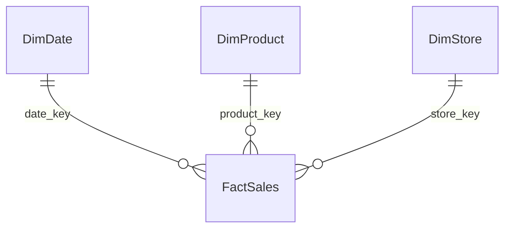

# 6.6–6.8. Моделювання та візуалізація

> Модуль 6 · за програмою + опис LMS (субтитри 6.6–6.8 відсутні)

---

## 6.6. Моделювання

Мета: щоб Power BI розумів, **як таблиці пов’язані**. Перехід від очистки до структури взаємодії таблиць (зазвичай star: fact + dims).

| Таблиця | Приклад |
|---------|---------|
| Fact | продажі |
| Dim | дата, товар, магазин, план |

Зв’язки переважно **1:*** від виміру до факту. Календарна Date — must-have далі для DAX time intel.

## 6.7. Візуалізація · частина 1

З чого складається звіт; як перетворювати дані на зрозумілі візуали. Принцип: одне управлінське питання на екран.

## 6.8. Візуалізація · частина 2

Таблиці / деталізація; **Drill Down** — від загального до деталей. Slicers і взаємодія візуалів.

---

## Самоперевірка

1. Чому fact не дублює назву товару без ключа?  
2. Drill down vs окремий звіт?
