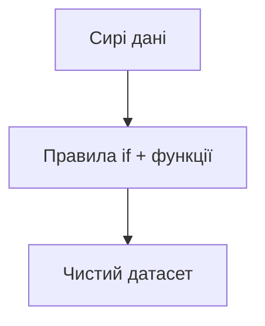

# 7.1–7.4. Python для аналітика: вступ і структури

> Модуль 7 · Основи Python · Ганна Шепелєва  
> Каркас за програмою; деталі з відео — після LMS

---

## 7.1–7.2. Вступ + практика

Навіщо Python аналітику: автоматизація вигрузок, очистка, pandas-аналіз, візуалізація, повторювані звіти.

База мови:
- змінні, типи (`int`, `float`, `str`, `bool`, `None`);
- списки / словники (зв’язок із ARRAY/STRUCT у BigQuery);
- функції `def`, читабельні імена;
- середовище: Jupyter / Colab / IDE + `pip`/`venv`.

Практика: перші комірки notebook — print, арифметика, простий скрипт читання файлу.

## 7.3–7.4. Структури програмування

| Конструкція | Навіщо в аналітиці |
|-------------|-------------------|
| `if / elif / else` | правила сегментів, флаги якості даних |
| функції | не копіпастити однакові кроки |
| помилки / `try` (орієнтир) | стійкі пайплайни завантаження |

---

## Самоперевірка

1. list vs dict — аналогія з чим у SQL/BQ?  
2. Коли винести код у функцію?
