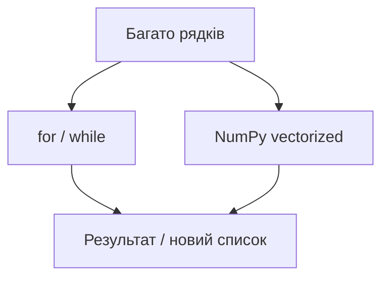

# 7.5–7.6. Цикли та NumPy

> Модуль 7 · за автосубтитрами

---

## 7.5. Цикли

Проблема: 40k рядків продажів руками неперевірювані. Цикл = одне правило на всі рядки, наступного місяця — лише rerun.

| Конструкція | Коли |
|-------------|------|
| `for` (~95% кейсів) | пройти список, накопичення, новий список |
| `while` | поки умова (зв’язок з `if`) |
| `enumerate` | індекс + значення |
| `range(a, b)` | b **не включно**; третій аргумент = крок |

Правило імен: список `prices` → змінна циклу `price` («для кожної ціни зі списку цін»).

Увага: двокрапка після `for`/`if` + **4 пробіли** відступу — найчастіша помилка новачків.

## 7.6. NumPy (векторизація)

Альтернатива циклу: одна операція над усім масивом.

- `array`, `shape`, `axis` (0/1 — рядки/стовпці)  
- `linspace`, `cumsum` (накопичення LTV/транзакцій з початку року)  
- `min`/`max`/`sum` по axis  
- маски True/False, множення всього масиву на коефіцієнт (напр. +20%)  
- `reshape` / transpose  

Підсумок лекції: цикл іде по елементах; NumPy — векторно; результат той самий принцип «одне правило на багато значень». Завжди `import numpy` на старті сесії.

---

## Самоперевірка

1. Коли `while`, а не `for`?  
2. Навіщо `cumsum` аналітику?  
3. `range(1, 5)` — які числа?
