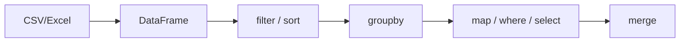

# 7.7–7.8. Pandas

> Модуль 7 · за автосубтитрами

---

## 7.7. Фільтри, сортування, groupby

**DataFrame** ≈ таблиця; колонки в лапках і часто в `[]`.

| Дія | Як |
|-----|-----|
| Сортування | `sort_values(..., ascending=...)`; кілька колонок — список + список ascending |
| Індекс | `reset_index` після сорту/join, якщо індекс заважає |
| Фільтр | булеві маски; кілька умов — `&` / `\|` і **дужки** навколо кожної |
| Список значень | `isin(['North','West'])` |
| Агрегація | `groupby` ≈ SQL GROUP BY / зведена |

Паттерн: фільтр → **нова змінна** (`big = df[df.sales > 5000]`), не ламати вихідний df без потреби.

## 7.8. Нові колонки, merge, читання файлів

Три способи «як if» для колонок:
1. **`map`** — словник замін по одному стовпцю (`cash`→`готівка`). Спочатку `unique()`, потім map; перевірка — вивести старий+новий стовпець.  
2. **`np.where`** — бінарна умова (`sales > 5000` → high/low).  
3. **`np.select`** — кілька умов + `default=None` (обов’язковий «страхувальний» default).

**`merge`** — join таблиць (`on='product_id'`; default inner). Після merge можна одразу рахувати нові поля.

**`read_csv`**: `encoding` (кирилиця / Windows), `sep`, `decimal` для української локалі (кома як десятковий роздільник).

---

## Самоперевірка

1. Чому `&` без дужок у фільтрі падає?  
2. map vs np.select?  
3. Які параметри `read_csv` рятують «кракозябри»?
