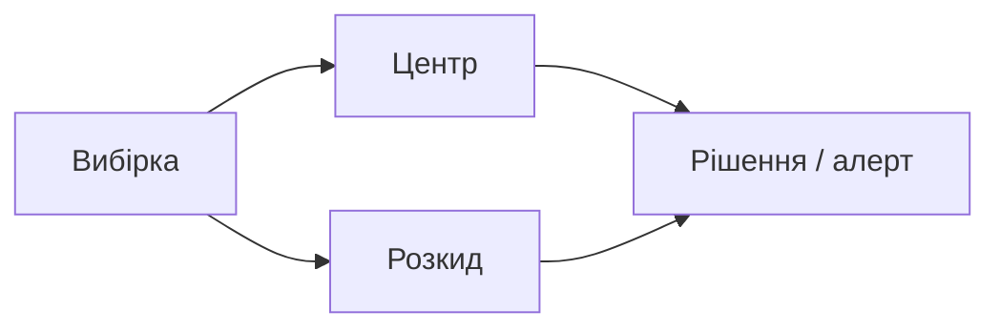

# 8.1–8.3. Навіщо статистика; розмах, дисперсія, відхилення

> Модуль 8 · Статистика · Ганна Шепелєва  
> Каркас за програмою + опис LMS (у плеєрі більшості уроків немає субтитрів)

---

## 8.1. Навіщо аналітику

Статистика відповідає: «чи різниця реальна, чи шум?», «який типовий клієнт?», «де аномалія?». Без цього дашборд легко бреше.

## 8.2–8.3. Прості поняття + розкид

| Показник | Інтуїція |
|----------|----------|
| Розмах (range) | max − min — грубий розкид |
| Середнє відхилення | середня \|x − mean\| |
| Дисперсія / σ² | середній квадрат відхилень |
| Std (σ) | «типовий» розкид у тих самих одиницях, що дані |

Висока дисперсія при однаковому середньому = нестабільний процес (виручка, час доставки).

---

## Самоперевірка

1. Чому одного середнього мало для KPI?  
2. Std vs range — що стійкіше до одного викиду?
