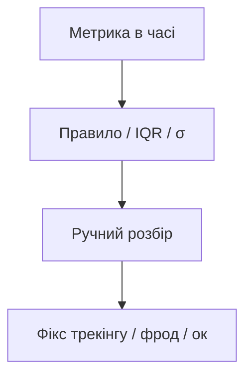

# 8.7–8.8. Виявлення аномалій

> Модуль 8 · теорія + практика

---

## Головна ідея

**Аномалія** — точка (або період), що різко вибивається з очікуваного патерну: фрод, баг трекінгу, вірусний пік, збій оплат.

Базові підходи:
- правило σ (напр. \|x − mean\| > 3σ) — для приблизно нормальних даних;
- IQR / boxplot: нижче Q1−1.5·IQR або вище Q3+1.5·IQR;
- порівняння з сезонністю / DOW (понеділок ≠ неділя);
- бізнес-правила (amount > ліміт картки, країна ≠ geo IP).

Практика: не видаляй «викид» автоматично — спочатку зрозумій причину.

---

## Самоперевірка

1. Чому 3σ погано працює на дуже скішених sales?  
2. Аномалія в дашборді — завжди бізнес-проблема?
